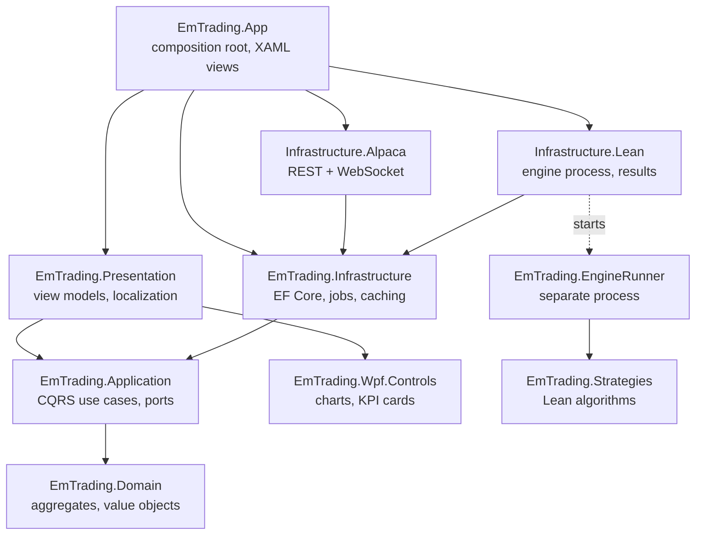
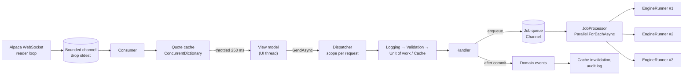

# EmTrading

[](https://github.com/emskypl/em-trading/actions/workflows/backend-ci.yml)

A Windows desktop app for researching and trading US equities:
- download market data from Alpaca;
- backtest and optimize strategies with the QuantConnect Lean engine;
- analyze risk with Monte Carlo simulation;
- trade through Alpaca's API (paper by default; live only with explicit opt-in).

**Stack:** .NET 10, WPF, CommunityToolkit.Mvvm, EF Core (SQLite), FluentValidation, HybridCache, Polly (Microsoft.Extensions.Http.Resilience), System.Threading.Channels, QuantConnect Lean, ScottPlot, Serilog, xUnit v3, NetArchTest, BenchmarkDotNet.

## Features

| Area | What it does |
|---|---|
| **Market data** | Downloads minute/hour/daily bars for many symbols in parallel, as background jobs. Only missing days are fetched. Requests are rate-limited (200/min), retried, and streamed page by page into Lean's zip format. |
| **Backtesting** | Each backtest runs the Lean engine in its own process, with real progress over stdout, cancellation (kills the process tree), and several runs in parallel. Strategy parameters come from attributes, so the input form is generated. History and side-by-side comparison of runs. |
| **Optimization** | Grid search over 1–3 parameters. Trials run as parallel engine processes; the best trial is picked by Sharpe ratio, net profit or return/drawdown. Results show as a heatmap and a trial table, and the best parameters can be sent to the backtest form. |
| **Risk analysis** | Monte Carlo simulation of a run's trades (shuffle or bootstrap), computed in parallel and deterministic for a given seed. Shows percentiles, equity paths, the drawdown distribution, and the deepest drawdown periods. |
| **Trading** | Live quotes and minute candles over WebSocket. Order ticket (market/limit/stop/stop-limit) with pre-trade risk checks and confirmation. Positions with close / close all, orders with cancel. Order events arrive from the trade-updates stream, and periodic reconciliation catches any that were missed. |
| **Safety** | Paper trading by default. Live trading needs a config flag, dedicated keys, and per-session arming by typing the account number. Kill switch, daily-loss halt, and an append-only audit log. |
| **UX** | Navigation shell, PL/EN switchable at runtime, input validation, live progress for every background job, in-app log viewer. |

## Architecture

Clean Architecture: dependencies point inwards, and the rules are enforced by [architecture tests](backend/tests/EmTrading.Architecture.Tests/LayerDependencyTests.cs).



How work flows at runtime:



## Skills: where to look in the code

| Skill | Where |
|---|---|
| **CQRS** (own dispatcher, no MediatR) | [Dispatcher](backend/EmTrading.Application/Messaging/Dispatcher.cs): cached generic wrappers, one DI scope per request. Pipeline behaviors: [logging, validation, unit of work, caching](backend/EmTrading.Application/Behaviors). Features are vertical slices, e.g. [StartOptimization](backend/EmTrading.Application/Optimization/StartOptimization/StartOptimizationCommand.cs). |
| **DDD** | Aggregates with state machines and domain events: [BacktestRun](backend/EmTrading.Domain/Backtesting/BacktestRun.cs), [OptimizationRun](backend/EmTrading.Domain/Optimization/OptimizationRun.cs), [Order](backend/EmTrading.Domain/Trading/Order.cs) (idempotent fills), [MarketDataSet](backend/EmTrading.Domain/MarketData/MarketDataSet.cs) (coverage gaps). Domain service: [RiskPolicy](backend/EmTrading.Domain/Trading/RiskPolicy.cs). Events are published only after commit by the [unit of work](backend/EmTrading.Infrastructure/Persistence/Repositories.cs). |
| **Background workers** | [JobProcessor](backend/EmTrading.Infrastructure/Jobs/JobProcessor.cs) over a [Channel-based queue](backend/EmTrading.Infrastructure/Jobs/JobQueue.cs) (dedupe, cancel, progress). WebSocket [stream services](backend/EmTrading.Infrastructure.Alpaca/Streaming/AlpacaStreamService.cs) with reconnect backoff. Reconciliation and daily-loss guard on `PeriodicTimer`. |
| **Multithreading** | Parallel downloads and backtests. Parallel optimization trials sharing one aggregate behind an async lock: [ExecuteOptimization](backend/EmTrading.Application/Optimization/ExecuteOptimization/ExecuteOptimizationCommand.cs). [Monte Carlo](backend/EmTrading.Application/Analytics/MonteCarloSimulator.cs) with `Parallel.For` thread-local accumulators and per-block seeding, so it is deterministic. Parallel minute-to-daily [aggregation](backend/EmTrading.Infrastructure.Lean/Data/LeanPriceBarReader.cs). |
| **Producer/consumer** | Download pipeline in [MarketDataDownloader](backend/EmTrading.Infrastructure/MarketData/MarketDataDownloader.cs). Live market data: socket reader → bounded drop-oldest channel → consumer, in [AlpacaMarketDataStream](backend/EmTrading.Infrastructure.Alpaca/MarketData/AlpacaMarketDataStream.cs). |
| **Async/await** | Engine process streaming and cancellation in [LeanBacktestEngine](backend/EmTrading.Infrastructure.Lean/Engine/LeanBacktestEngine.cs). `IAsyncEnumerable` paging. CPU work moved off the UI thread with `Task.Run`. A submit that must not be cancelled half-way: [PlaceOrder](backend/EmTrading.Application/Trading/Orders/PlaceOrderCommand.cs). |
| **WPF / MVVM** | View-model-first shell, singleton pages, messenger. [ThrottledAction](backend/EmTrading.Presentation/Common/ThrottledAction.cs) coalesces worker-thread updates. INotifyDataErrorInfo forms. Reusable [ScottPlot controls](backend/EmTrading.Wpf.Controls/Charts) (equity/drawdown, candles with trades, heatmap, histogram). Runtime PL/EN through [Loc](backend/EmTrading.Presentation/Localization/Loc.cs). |
| **Caching** | [CachingBehavior](backend/EmTrading.Application/Behaviors/CachingBehavior.cs) on HybridCache (tags, stampede protection, failures not cached). Invalidation through domain events, e.g. [prices](backend/EmTrading.Application/MarketData/GetPriceBars/GetPriceBarsQuery.cs) and the account. The incremental data cache lives in `MarketDataSet`. |
| **Resilience** | Polly retries, circuit breaker and timeouts. Shared [token-bucket rate limiter](backend/EmTrading.Infrastructure.Alpaca/AlpacaRateLimiting.cs). [No retries for orders](backend/EmTrading.Infrastructure.Alpaca/AlpacaDependencyInjection.cs) (`DisableForUnsafeHttpMethods`) plus idempotent client order ids. |
| **Trading safety** | [Paper/live guard and arming, daily-loss halt, audit trail](backend/EmTrading.Application/Trading/Safety/TradingSafety.cs). [Startup validation of the live opt-in](backend/EmTrading.Infrastructure.Alpaca/AlpacaOptions.cs). |
| **Testing** | 309 tests:<br>• unit tests: domain, handlers;<br>• integration: SQLite with real migrations, HTTP stubs, a scripted WebSocket fake;<br>• architecture and convention tests;<br>• pixel tests for charts.<br>Plus [BenchmarkDotNet](backend/benchmarks/EmTrading.Benchmarks/MonteCarloBenchmarks.cs). |

## Getting started

Requirements: Windows and the .NET 10 SDK. Market data and trading need a free [Alpaca](https://alpaca.markets) account.

```powershell
cd backend
dotnet user-secrets set "Alpaca:ApiKey" "<key>" --project EmTrading.App
dotnet user-secrets set "Alpaca:ApiSecret" "<secret>" --project EmTrading.App
# Paper trading account keys, if different from the keys above:
dotnet user-secrets set "Alpaca:TradingApiKey" "<paper key>" --project EmTrading.App
dotnet user-secrets set "Alpaca:TradingApiSecret" "<paper secret>" --project EmTrading.App

dotnet run --project EmTrading.App
```

Then:
1. Download a symbol (and SPY, added automatically) on **Market data**.
2. Run a backtest, optimize it, and analyze its risk.
3. Trade on the paper account on **Paper trading**.

Data, results and the SQLite database go to the folders under `Storage` in `appsettings.json`. Logs go to `%LOCALAPPDATA%\EmTrading\logs`.

### Live trading (real money)

Live trading is off by default and needs every one of these steps:

1. Set `Alpaca:TradingMode` to `Live` **and** `Alpaca:LiveTradingEnabled` to `true`.
2. Store dedicated `Alpaca:LiveApiKey` / `Alpaca:LiveApiSecret` keys. They must differ from the paper and data keys, and there is no fallback to them.
3. In the app, **arm** live trading for the session by typing the account number. The app always starts disarmed.

Startup fails if any setting is missing. In live mode every order still goes through:
- the risk limits (`Trading:Risk`);
- the kill switch;
- the daily-loss halt;
- a confirmation dialog;
- the audit log.

## Tests, coverage and benchmarks

```powershell
cd backend
dotnet test --solution EmTradingSolution.slnx
dotnet test --solution EmTradingSolution.slnx --coverage --coverage-output-format cobertura --results-directory TestResults
dotnet run -c Release --project benchmarks/EmTrading.Benchmarks -- --filter "*MonteCarlo*"
```

CI builds, tests and publishes a coverage report on every push.

Line coverage at the time of writing:

| Assembly | Coverage |
|---|---|
| Domain | 96% |
| Application | 94% |
| Infrastructure | 86% |
| Infrastructure.Alpaca | 74% |
| Infrastructure.Lean | 63% |

The WPF layers are covered by view-model, localization and chart tests rather than UI automation.

Monte Carlo benchmark (100 trades, 24 logical cores):

| Simulations | Method | Sequential | Parallel | Speed-up |
|---|---|---|---|---|
| 10,000 | Shuffle | 19.0 ms | 1.9 ms | 10× |
| 100,000 | Shuffle | 186.9 ms | 20.4 ms | 9× |
| 100,000 | Bootstrap | 160.1 ms | 27.1 ms | 6× |

## Not yet done

- Walk-forward optimization.
- Order notifications (Telegram/Discord).
- Screenshots in this README.
