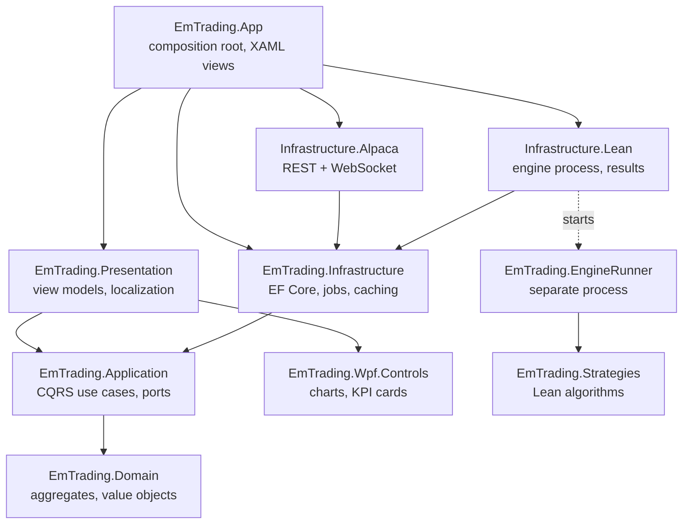
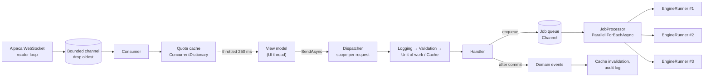
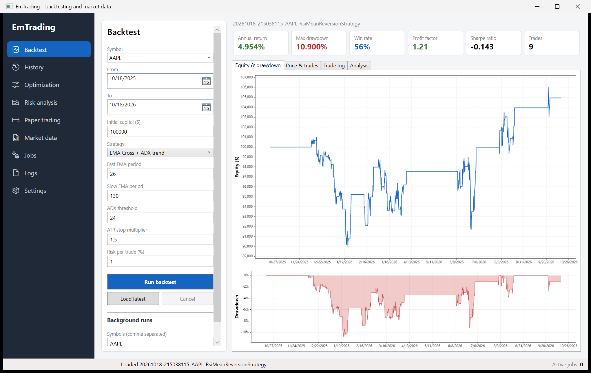
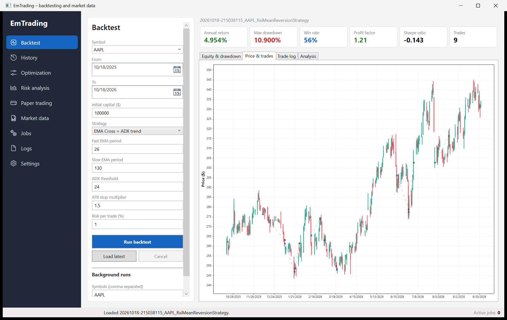
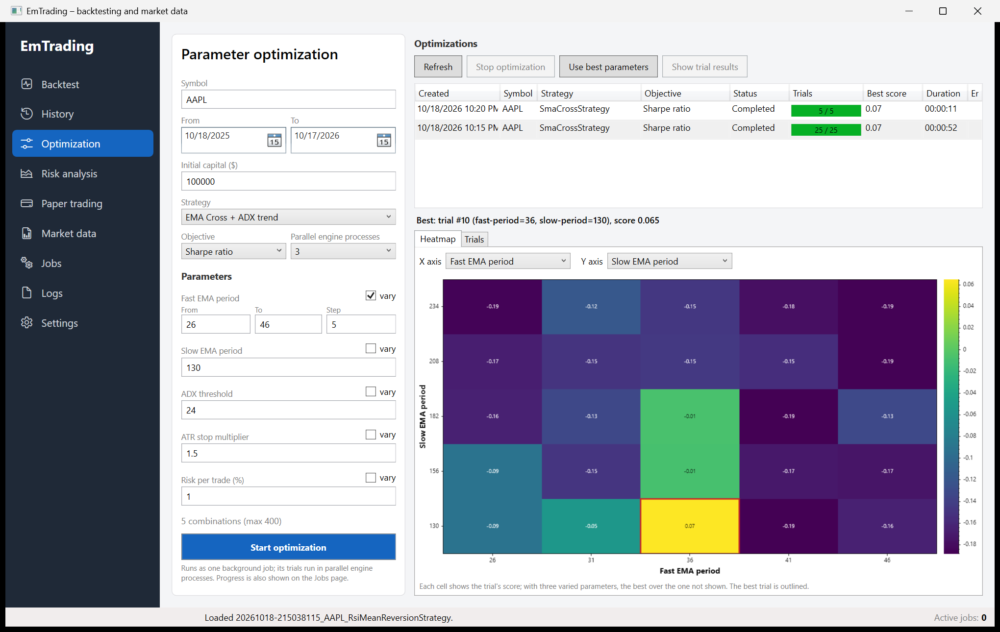
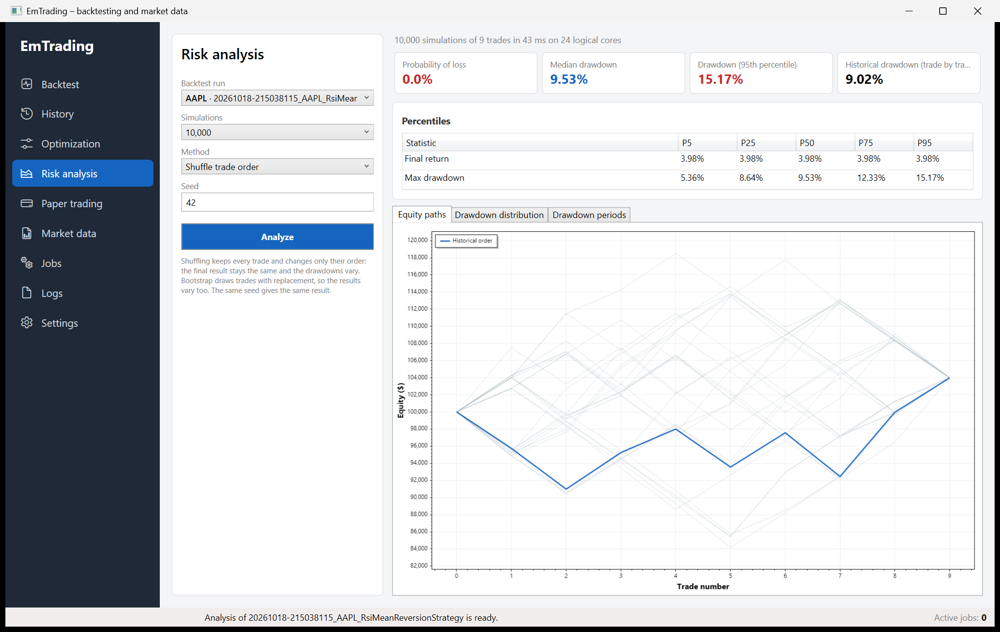
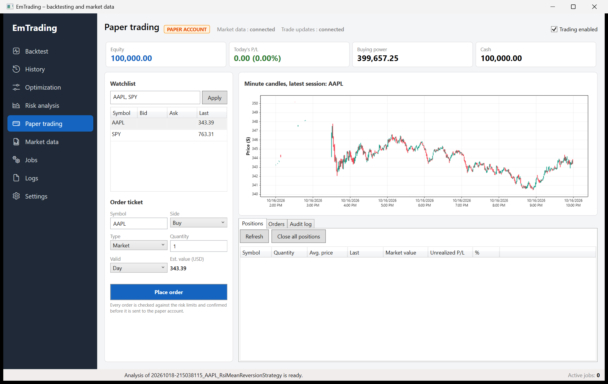

# EmTrading

[](https://github.com/emskypl/em-trading/actions/workflows/backend-ci.yml)

A Windows desktop app for researching and trading US equities:
- download market data from Alpaca;
- backtest and optimize strategies with the QuantConnect Lean engine;
- analyze risk with Monte Carlo simulation;
- trade through Alpaca's API (paper by default; live only with explicit opt-in).

**Stack:** .NET 10, WPF, CommunityToolkit.Mvvm, EF Core (SQLite), FluentValidation, HybridCache, Polly (Microsoft.Extensions.Http.Resilience), System.Threading.Channels, QuantConnect Lean, ScottPlot, Serilog, xUnit v3, NetArchTest, BenchmarkDotNet.

## Features

| Area | What it does |
|---|---|
| **Market data** | Downloads minute/hour/daily bars for many symbols in parallel, as background jobs. Only missing days are fetched. Requests are rate-limited (200/min), retried, and streamed page by page into Lean's zip format. |
| **Backtesting** | Each backtest runs the Lean engine in its own process, with real progress over stdout, cancellation (kills the process tree), and several runs in parallel. Strategy parameters come from attributes, so the input form is generated. History and side-by-side comparison of runs. |
| **Optimization** | Grid search over 1–3 parameters. Trials run as parallel engine processes; the best trial is picked by Sharpe ratio, net profit or return/drawdown. Results show as a heatmap and a trial table, and the best parameters can be sent to the backtest form. |
| **Risk analysis** | Monte Carlo simulation of a run's trades (shuffle or bootstrap), computed in parallel and deterministic for a given seed. Shows percentiles, equity paths, the drawdown distribution, and the deepest drawdown periods. |
| **Trading** | Live quotes and minute candles over WebSocket. Order ticket (market/limit/stop/stop-limit) with pre-trade risk checks and confirmation. Positions with close / close all, orders with cancel. Order events arrive from the trade-updates stream, and periodic reconciliation catches any that were missed. |
| **Safety** | Paper trading by default. Live trading needs a config flag, dedicated keys, and per-session arming by typing the account number. Kill switch, daily-loss halt, and an append-only audit log. |
| **UX** | Navigation shell, PL/EN switchable at runtime, input validation, live progress for every background job, in-app log viewer. |

## Architecture

Clean Architecture: dependencies point inwards, and the rules are enforced by [architecture tests](backend/tests/EmTrading.Architecture.Tests/LayerDependencyTests.cs).



How work flows at runtime:



## Skills: where to look in the code

| Skill | Where |
|---|---|
| **CQRS** (own dispatcher, no MediatR) | [Dispatcher](backend/EmTrading.Application/Messaging/Dispatcher.cs): cached generic wrappers, one DI scope per request. Pipeline behaviors: [logging, validation, unit of work, caching](backend/EmTrading.Application/Behaviors). Features are vertical slices, e.g. [StartOptimization](backend/EmTrading.Application/Optimization/StartOptimization/StartOptimizationCommand.cs). |
| **DDD** | Aggregates with state machines and domain events: [BacktestRun](backend/EmTrading.Domain/Backtesting/BacktestRun.cs), [OptimizationRun](backend/EmTrading.Domain/Optimization/OptimizationRun.cs), [Order](backend/EmTrading.Domain/Trading/Order.cs) (idempotent fills), [MarketDataSet](backend/EmTrading.Domain/MarketData/MarketDataSet.cs) (coverage gaps). Domain service: [RiskPolicy](backend/EmTrading.Domain/Trading/RiskPolicy.cs). Events are published only after commit by the [unit of work](backend/EmTrading.Infrastructure/Persistence/Repositories.cs). |
| **Background workers** | [JobProcessor](backend/EmTrading.Infrastructure/Jobs/JobProcessor.cs) over a [Channel-based queue](backend/EmTrading.Infrastructure/Jobs/JobQueue.cs) (dedupe, cancel, progress). WebSocket [stream services](backend/EmTrading.Infrastructure.Alpaca/Streaming/AlpacaStreamService.cs) with reconnect backoff. Reconciliation and daily-loss guard on `PeriodicTimer`. |
| **Multithreading** | Parallel downloads and backtests. Parallel optimization trials sharing one aggregate behind an async lock: [ExecuteOptimization](backend/EmTrading.Application/Optimization/ExecuteOptimization/ExecuteOptimizationCommand.cs). [Monte Carlo](backend/EmTrading.Application/Analytics/MonteCarloSimulator.cs) with `Parallel.For` thread-local accumulators and per-block seeding, so it is deterministic. Parallel minute-to-daily [aggregation](backend/EmTrading.Infrastructure.Lean/Data/LeanPriceBarReader.cs). |
| **Producer/consumer** | Download pipeline in [MarketDataDownloader](backend/EmTrading.Infrastructure/MarketData/MarketDataDownloader.cs). Live market data: socket reader → bounded drop-oldest channel → consumer, in [AlpacaMarketDataStream](backend/EmTrading.Infrastructure.Alpaca/MarketData/AlpacaMarketDataStream.cs). |
| **Async/await** | Engine process streaming and cancellation in [LeanBacktestEngine](backend/EmTrading.Infrastructure.Lean/Engine/LeanBacktestEngine.cs). `IAsyncEnumerable` paging. CPU work moved off the UI thread with `Task.Run`. A submit that must not be cancelled half-way: [PlaceOrder](backend/EmTrading.Application/Trading/Orders/PlaceOrderCommand.cs). |
| **WPF / MVVM** | View-model-first shell, singleton pages, messenger. [ThrottledAction](backend/EmTrading.Presentation/Common/ThrottledAction.cs) coalesces worker-thread updates. INotifyDataErrorInfo forms. Reusable [ScottPlot controls](backend/EmTrading.Wpf.Controls/Charts) (equity/drawdown, candles with trades, heatmap, histogram). Runtime PL/EN through [Loc](backend/EmTrading.Presentation/Localization/Loc.cs). |
| **Caching** | [CachingBehavior](backend/EmTrading.Application/Behaviors/CachingBehavior.cs) on HybridCache (tags, stampede protection, failures not cached). Invalidation through domain events, e.g. [prices](backend/EmTrading.Application/MarketData/GetPriceBars/GetPriceBarsQuery.cs) and the account. The incremental data cache lives in `MarketDataSet`. |
| **Resilience** | Polly retries, circuit breaker and timeouts. Shared [token-bucket rate limiter](backend/EmTrading.Infrastructure.Alpaca/AlpacaRateLimiting.cs). [No retries for orders](backend/EmTrading.Infrastructure.Alpaca/AlpacaDependencyInjection.cs) (`DisableForUnsafeHttpMethods`) plus idempotent client order ids. |
| **Trading safety** | [Paper/live guard and arming, daily-loss halt, audit trail](backend/EmTrading.Application/Trading/Safety/TradingSafety.cs). [Startup validation of the live opt-in](backend/EmTrading.Infrastructure.Alpaca/AlpacaOptions.cs). |
| **Testing** | 314 tests:<br>• unit tests: domain, handlers;<br>• integration: SQLite with real migrations, HTTP stubs, a scripted WebSocket fake;<br>• architecture and convention tests;<br>• pixel tests for charts.<br>Plus [BenchmarkDotNet](backend/benchmarks/EmTrading.Benchmarks/MonteCarloBenchmarks.cs). |

## Getting started

Requirements: Windows and the .NET 10 SDK. Market data and trading need a free [Alpaca](https://alpaca.markets) account.

```powershell
cd backend
dotnet user-secrets set "Alpaca:ApiKey" "<key>" --project EmTrading.App
dotnet user-secrets set "Alpaca:ApiSecret" "<secret>" --project EmTrading.App
# Paper trading account keys, if different from the keys above:
dotnet user-secrets set "Alpaca:TradingApiKey" "<paper key>" --project EmTrading.App
dotnet user-secrets set "Alpaca:TradingApiSecret" "<paper secret>" --project EmTrading.App

dotnet run --project EmTrading.App
```

Data, results and the SQLite database go to the folders under `Storage` in `appsettings.json`. Logs go to `%LOCALAPPDATA%\EmTrading\logs`. The UI starts in Polish; switch to English under **Settings → Language** (the change applies at once and is remembered).

## How to use: a walkthrough

The examples below take one symbol from raw data to a paper trade. Each step names the page in the sidebar.

### 1. Download market data (Market data)

1. Enter the symbols, e.g. `AAPL, MSFT`, choose the interval (**Minute** for the strategies below) and the period, e.g. the last 12 months.
2. Click **Download**. Each symbol becomes a background job, and SPY (daily) is added automatically as the benchmark.
3. Watch the progress on the **Jobs** page; jobs can be cancelled there.

Downloading the same range again fetches only the days that are missing, so a daily refresh takes seconds. The **Stored locally** table shows which days each symbol has; select a row to preview its candles.

### 2. Run a backtest (Backtest)

Example: AAPL, the last 12 months, $100,000, strategy **EMA Cross + ADX trend** with its defaults (fast EMA 26, slow EMA 130).

1. Fill in the form; the parameter fields come from the strategy's own definition and are checked as you type.
2. Click **Run backtest**. The engine runs as a separate process; the status bar shows its progress, and **Cancel** stops it.
3. The report shows the key figures, then four tabs:
   - **Equity & drawdown**: the equity curve with the drawdown below it.
   - **Price & trades**: daily candles with entries (triangles) and exits (circles: green for a win, red for a loss).
   - **Trade log**: every closed trade.
   - **Analysis**: average win and loss, and the longest winning and losing streaks.





To test one setup on several symbols, enter them under **Background runs** (e.g. `AAPL, MSFT, MMM`) and click **Run for the list in background**. Up to three engines run at once; results appear in **History**.

### 3. Compare runs (History)

Every run is stored, including failed and cancelled ones. Select 2–8 completed runs (Ctrl/Shift + click) and click **Compare selected** to see their key figures side by side and their returns on one chart. **Show results** opens a run on the Backtest page.

### 4. Optimize parameters (Optimization)

Example: find the best EMA periods for AAPL.

1. Choose the symbol, the period and the strategy. Under **Parameters**, tick **vary** for *Fast EMA period* (from 26 to 46, step 5) and *Slow EMA period* (from 130 to 234, step 26). The form shows **25 combinations**.
2. Choose the **Objective** (Sharpe ratio, net profit, or return divided by maximum drawdown) and the number of **Parallel engine processes**, e.g. 3.
3. Click **Start optimization**. It runs as one background job; the table shows trials finished out of the total, and you can stop it at any time without losing finished trials.
4. When it is done, the **heatmap** shows the score of every combination, with the best one outlined, and **Trials** lists them all. On a 24-core machine the 25 trials above take under a minute.
5. Click **Use best parameters** to copy them to the backtest form, or **Show trial results** to open any trial's full report.

Combinations a strategy cannot use (e.g. a slow period not above the fast one) are skipped automatically.



### 5. Analyze the risk of a run (Risk analysis)

In **History**, select a completed run and click **Analyze risk**, or pick it on the **Risk analysis** page.

- **Shuffle trade order** (default) keeps every trade and changes only their order. The final result stays the same, but the drawdowns vary. It answers: *how deep could the drawdown have been with the same trades in a less lucky order?*
- **Bootstrap** draws trades with replacement, so final results vary too. It answers: *how different could the result have been?*

The same seed always gives the same result. Read the output like this:
- **Probability of loss** and the **percentile table** show the spread of outcomes: for example, a 95th percentile drawdown of 15% means 1 simulation in 20 was worse.
- **Drawdown distribution** shows where the historical drawdown falls among them.
- **Drawdown periods** lists the deepest real drawdowns, with how long they took to recover.



### 6. Paper trading (Paper trading)

Needs paper trading keys (see *Getting started*); the page shows **PAPER ACCOUNT** and the state of both live connections.

1. **Watchlist**: enter symbols, e.g. `AAPL, SPY`, and click **Apply**. Prices stream live while the market is open; outside trading hours the last price and the latest session's minute candles are shown.
2. **Order ticket**, example: Buy, Market, quantity 1, Day. The ticket estimates the value from the live price. **Place order** checks the risk limits and asks for confirmation before anything is sent.
3. The order then appears under **Orders** (it fills when the market is open), and the position under **Positions**, with its current value and unrealized P/L.
4. **Close** sells (or buys back) a whole position with a market order. **Close all positions** first cancels open orders, then closes everything.
5. **Audit log** records every step: order created, submitted, filled or cancelled, refusals by the risk checks, and kill switch changes.

Example of a refused order: buying 100 AAPL at about $340 is worth $34,000, above the default limit of $10,000 per order. The order is not sent; the status bar explains which limit stopped it, and the refusal is in the audit log.

**Trading enabled** is the kill switch: when unticked, only orders that reduce a position are accepted. It also switches off automatically once the day's loss reaches `Trading:Risk:MaxDailyLoss`.



### Configuration reference

Settings live in `backend/EmTrading.App/appsettings.json`; keys go to user secrets (see above).

| Setting | Default | Meaning |
|---|---|---|
| `Storage:DataFolder`, `ResultsFolder`, `DatabaseFile` | under `backend/` | Where market data, backtest results and the SQLite database are stored. |
| `Jobs:MaxParallelJobs` | 3 | Background jobs (downloads, backtests) running at once. |
| `Alpaca:Feed` | `iex` | Market data feed; `sip` needs a paid plan. |
| `Alpaca:RequestsPerMinute` | 200 | API rate limit of your plan. |
| `Alpaca:TradingMode` / `LiveTradingEnabled` | `Paper` / `false` | See *Live trading* below. |
| `Trading:Risk:MaxOrderNotional` | 10,000 | Largest single order, USD. |
| `Trading:Risk:MaxPositionNotional` | 25,000 | Largest position in one symbol, USD. |
| `Trading:Risk:MaxDailyLoss` | 1,000 | Day loss that halts new exposure, USD. |
| `Trading:Risk:MaxOpenOrders` | 10 | Orders working at the broker at once. |

### Live trading (real money)

Live trading is off by default and needs every one of these steps:

1. Set `Alpaca:TradingMode` to `Live` **and** `Alpaca:LiveTradingEnabled` to `true`.
2. Store dedicated `Alpaca:LiveApiKey` / `Alpaca:LiveApiSecret` keys. They must differ from the paper and data keys, and there is no fallback to them.
3. In the app, **arm** live trading for the session by typing the account number. The app always starts disarmed.

Startup fails if any setting is missing. In live mode every order still goes through:
- the risk limits (`Trading:Risk`);
- the kill switch;
- the daily-loss halt;
- a confirmation dialog;
- the audit log.

## Tests, coverage and benchmarks

```powershell
cd backend
dotnet test --solution EmTradingSolution.slnx
dotnet test --solution EmTradingSolution.slnx --coverage --coverage-output-format cobertura --results-directory TestResults
dotnet run -c Release --project benchmarks/EmTrading.Benchmarks -- --filter "*MonteCarlo*"
```

CI builds, tests and publishes a coverage report on every push.

Line coverage at the time of writing:

| Assembly | Coverage |
|---|---|
| Domain | 96% |
| Application | 94% |
| Infrastructure | 86% |
| Infrastructure.Alpaca | 74% |
| Infrastructure.Lean | 63% |

The WPF layers are covered by view-model, localization and chart tests rather than UI automation.

Monte Carlo benchmark (100 trades, 24 logical cores):

| Simulations | Method | Sequential | Parallel | Speed-up |
|---|---|---|---|---|
| 10,000 | Shuffle | 19.0 ms | 1.9 ms | 10× |
| 100,000 | Shuffle | 186.9 ms | 20.4 ms | 9× |
| 100,000 | Bootstrap | 160.1 ms | 27.1 ms | 6× |

## Not yet done

- Walk-forward optimization.
- Order notifications (Telegram/Discord).
- Opening a run from History shows its report, but does not load its strategy parameters into the backtest form.
